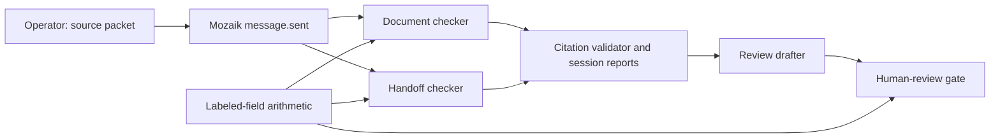

# RelayProof

Concurrent Mozaik agents turn a freight document packet into cited findings and an **unsent** operator-review draft.

Built by **Ajnas N B** on **31 October 2026** for JigJoy / NTP Novi Sad, **Freestyle** track. OpenAI Codex assisted implementation, tests and documentation. This is new event work, not a renamed existing product.

## Inspect the recorded demo

[Open the evidence viewer](https://ajnasnb.github.io/relayproof/) · [Actual model-run receipt](docs/receipt.json) · [Synthetic input packet](fixtures/shipment.json)

The viewer is a static replay of one recorded real-model run, not a live inference service. It shows observed timestamps, cited source excerpts, required arithmetic checks and the draft. To run fresh inference, follow the instructions below.

The invented example contains 12 cartons in the booking/invoice and 10 in the packing list. Expected documents arrive 90 minutes after the cutoff; departure is 900 minutes after that cutoff. Clearance remains pending. No real customer, carrier account, private document or operational integration is used.

## Why concurrent agents

Freight handoffs mix document consistency and timing questions. Two independent reviewers inspect the same immutable packet at once:

1. **document-checker** reviews carton quantities, weights and identifiers.
2. **handoff-checker** reviews cutoff/departure chronology and missing clearance.
3. **review-drafter** reacts only after both colleague reports arrive and pass citation validation. It combines findings into an operator draft.

These are three `createAgent` participants in a genuine `@mozaik-ai/core` **4.2.0** runtime. An operator's single `message.sent` event matches both checker situation handlers. Each invokes fire-and-forget `runLoop`; the runtime runs both loops concurrently. There is no `Promise.all` pretending that a single agent has two tools.

An observer receives `model.answer` events, validates the reports and stores them in this review session's shared report map. The second checker response triggers the drafter exactly once. Each agent has separate model context. The trace records inference start/end times and active call counts; the checked-in receipt contains the actual measured overlap. This measurement is application-side time around backend calls, not GPU-level scheduling or Mozaik Cloud telemetry.



## Run it

Requires Node.js **22+**, npm and a Cloudflare account with Workers AI access. Inference uses that account's quota and can incur charges. No credential is included in the repository.

```sh
npm ci
npm run types
npm run check
npm run check:worker
npm test
```

In terminal one, authenticate your own Cloudflare account if needed, then start the **local-only** inference bridge:

```sh
npx wrangler login
npm run bridge
```

In terminal two:

```sh
npm run demo
# Or provide a packet in the same bounded source schema:
npm run demo -- fixtures/shipment.json
```

The CLI writes `artifacts/latest.json`. `blocked_for_review` is a completed run with unresolved issues; `incomplete` means a backend/format/citation/deadline failure and exits nonzero. No result authorizes shipment release. The recorded demo can be inspected without credentials using GitHub Pages, `npm run viewer` (http://127.0.0.1:8790), or any static HTTP server serving `docs/`.

The backend is a custom Mozaik `InferenceRunner` which maps typed message context to a local Wrangler bridge. The bridge calls **Cloudflare Workers AI `@cf/meta/llama-3.3-70b-instruct-fp8-fast`** in JSON mode. Mozaik still owns agent participants, model context, situation handlers, event delivery and loop transitions. No cloud pairing or Mozaik API key is required. The bridge binds to `127.0.0.1`; it is not deployed as a public inference endpoint.

## Validation and limits

- Every finding requires at least one exact quote from a named input source. Unknown source IDs, invented quotes, uncited findings and malformed responses invalidate the report. Any invalid checker prevents synthesis and suppresses the usable draft.
- Independent labeled-field checks compare carton counts and compute document lateness. These checks add required operator questions even when a model omits them. They cover only the documented `booking`, `handoff` and quantity labels, not arbitrary document layouts.
- Source packets are limited to 12 sources and 9,000 text characters. Model calls have a 60-second timeout; a review has a 90-second completion deadline. There are at most three model calls per review, no tools or automatic retries.
- Source content is treated as untrusted data. No agent has email, payment, booking, filesystem-write or carrier tools. Prompts and source matching do **not** establish comprehensive prompt-injection protection.
- Quotes existing in documents do not prove their conclusions. An earlier live run made an incorrect date comparison; explicit computed timing facts were added after that observation. Human semantic review remains necessary. No perfect accuracy, authenticated document provenance, customs compliance or measured customer savings is claimed.
- Automated tests use fixture backends, clearly labeled as such. The checked-in demo receipt came from actual Workers AI calls. Tests exercise real Mozaik concurrency, citation failures, backend failure, arithmetic, gating and the structured-object transport regression.
- The replay viewer safely renders source/model text with `textContent`; it never executes model-generated HTML. It does not support uploading private documents.

## Project map

| Path                     | Purpose                                                 |
| ------------------------ | ------------------------------------------------------- |
| `src/review.ts`          | Mozaik participants, runner, validation and review gate |
| `src/cli.ts`             | Bounded packet input and receipt output                 |
| `worker/inference.ts`    | Local Cloudflare inference bridge                       |
| `fixtures/shipment.json` | Invented freight example                                |
| `tests/`                 | Deterministic regression and runtime tests              |
| `docs/`                  | Read-only recorded evidence viewer                      |

MIT licensed. Mozaik and dependencies retain their own licenses. No unrelated private project source was copied. Development runs in the creator's environment are evidence of this prototype, not customer adoption or production readiness.
